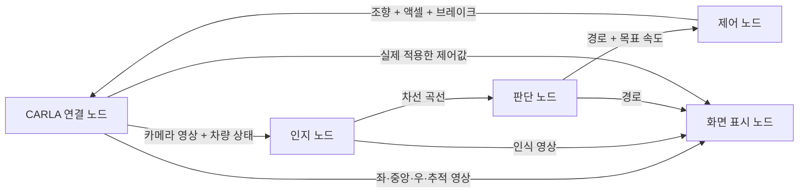

# ROS 2 토픽 기반 CARLA 주행

현재 기본 실행은 **서로 다른 프로세스의 ROS 2 노드 5개**입니다. 노드 사이에서는 Python 함수 호출 대신 DDS 토픽으로 데이터를 주고받습니다. 기존 알고리즘은 각 노드 안에서 계속 사용합니다.



## 1. 실행과 종료

이 노트북은 빌드를 완료했습니다. 새 터미널에서 한 줄을 입력하세요.

```bash
~/Desktop/PBB/start_ros2.sh
```

ROS 2 환경과 PBB 패키지 환경을 불러오고, CARLA 연결을 확인한 뒤 5개 노드를 실행합니다. Town10HD, Audi TT, 스폰 번호 21, 전방 카메라 3개와 추적 카메라 1개를 사용합니다. 주행 화면은 1200×828입니다. 노드 연결이 준비되면 자동으로 주행합니다.

요청 속도 기본값은 **60km/h**입니다. 곡선·무차선 구간까지 포함한 실제 평균 속도와는 구분합니다. 20km/h로 실행하려면:

```bash
~/Desktop/PBB/start_ros2.sh desired_speed_kmh:=20.0
```

`desired_speed_kmh`는 요청 속도입니다. 판단 파트의 차선 상태·곡률·가감속 제한에 따라 실제 제어 목표는 낮아질 수 있습니다.

화면의 `speed (km/h)`는 실제 차량 속도, `target (km/h)`는 이번 프레임의 목표입니다.
요청 상한은 80km/h입니다. 실제 목표는 현재 영상에서 보이는 차선 거리, 중심 오차, 곡률에 따라 결정합니다.

- 직선: 18m 이상 실제 차선이 보이고 방향·중앙이 0.7초 이상 안정되면 가속합니다. 주간은 한쪽·양쪽 모두 60km/h를 순항 목표로 사용합니다. 야간 한쪽 상한은 기존 55km/h입니다. 실제 관측 끝에서 25km/h로 줄일 수 있는 거리 여유도 적용하므로 이 상한에 항상 도달하는 것은 아닙니다.
- 곡선: 새로 관측한 곡률로 즉시 감속 목표를 낮추고, 직선으로 돌아온 뒤에는 천천히 다시 가속합니다. 곡률에 따라 28~35km/h 이하이며, 짧고 불확실한 관측만 있을 때도 고속 가속하지 않습니다.
- `NO LANES - STRAIGHT`: 양쪽 차선이 없으면 인식을 잃은 순간의 방향으로 직진하며 20km/h 목표로 감속합니다. 시작 준비 30프레임 뒤 최초 차선이 없어도 이 모드로 출발합니다. 이전의 2초·12m 소실 정지 한도는 이 모드에 적용하지 않습니다.
- `REACQUIRING - STRAIGHT`: 돌아온 차선을 확인 중입니다. 이동 보정 후 일치하는 관측 2회가 확인되면 정지 없이 중앙으로 부드럽게 복귀합니다. 0.3초 이내의 짧은 끊김은 확인을 초기화하지 않습니다.
- 좌·우 어느 한쪽의 현재 선이라도 이동 보정 후 두 번 일치하면 차로 폭으로 중앙을 복원합니다. 양쪽이 실제로 소실된 프레임은 항상 직진합니다. 선은 검출되지만 폭·경로가 일시적으로 모순되는 경우의 `VIRTUAL LANES` 보정은 기존처럼 최대 2초·12m이며 그 이후에는 정지합니다. 이 경우까지 모두 직진으로 확대했던 실험은 곡선 주행 악화로 제외했습니다.
- `RIGHT DOUBLE YELLOW - STOP`: 오른쪽 카메라에서 노란 이중선을 검출하거나 전방 이중선이 차량 오른쪽에 있다고 판정하면 목표 0, 액셀 0, 브레이크 1입니다. `CENTERLINE CROSSING - STOP`은 관측 중앙선과 계획 사이 차량 폭을 포함한 여유가 1.1m 미만일 때 적용합니다. 두 상태는 그 실행 세션에서 유지하며, 선이 잠시 사라졌다고 직진을 재개하지 않습니다. 다시 출발하려면 종료 후 차량을 새로 생성하는 전체 실행을 시작합니다. 상태 오류와 명령 시간 초과의 제동도 유지합니다.

인지에서는 중앙 카메라 신경망과 전방 좌·중앙·우 영상의 흰색·노란색 차선 픽셀을 결합합니다.
좌우 카메라의 ±45도 방향과 좌우 0.6m 장착 위치를 반영해 같은 좌표로 옮깁니다.
충분한 픽셀로 곡률을 새로 추정하며, 추적 중 짧은 점선은 이전 곡률을 보정합니다. 주간의 안정된 직선은 가까운 조향 곡선을 바꾸지 않고 최대 45m의 실제 차선 픽셀 연속성을 확인합니다. 관측이 끊기면 먼 픽셀까지 건너뛰지 않습니다. 주간 가속 상한은 3.0m/s², 야간은 기존 1.5m/s²입니다. 주간 직선의 짧은 인식 흔들림에는 안정도 상태를 서서히 낮추지만, 현재 곡률·관측 거리 제한은 즉시 반영합니다.
측면 카메라 재획득은 1.5~8m 범위의 가까운 현재 픽셀도 검사하며, 실패한 과거 추적 범위에 묶이지 않습니다. 실제 장착 각도·높이·화각 때문에 모든 위치의 선이 측면 카메라에 보이는 것은 아닙니다. `centerline.py`는 두 개의 얇은 노란 띠 간격·연속성·도로 방향을 검사해 일반 차선과 분리합니다.
우측 `OBSERVED LANE CURVES`는 실제 관측한 좌우 곡선, `MODEL`/`PAINT`/`YELLOW`, 관측 거리와 중앙선 경고를 표시합니다.
영상은 오른쪽 u+, 아래쪽 v+이고, 인지 도로 좌표는 전방 x+, 왼쪽 y+입니다. 판단에서 y를 한 번 반전해 CARLA 오른쪽 양수 조향으로 연결합니다. 단순한 화면 선의 기울기는 원근 때문에 직선에서도 달라지므로, 도로 좌표의 곡선으로 조향 방향을 정합니다.
좌상단 초록 선은 계획 중심, 노란 점선은 가상 경계입니다. 무차선 직진 중 `path error`는 `--`로 표시합니다.

`LaneEstimate`에 `centerline_coefficients`, `centerline_extent_m`, `right_double_yellow`가 추가되어 이번 변경은 `./build_ros2.sh` 후 전체 노드를 다시 시작해야 합니다. 토픽 이름과 노드 수는 같습니다.

실제 실행 파일은 `src/pbb_decision/pbb_decision/lane_planner.py`입니다. IDE의 옛 `aad/...` 경로와 구분하세요.
`LaneEstimate`에 현재 관측 거리 `left_extent_m`·`right_extent_m`가 추가되어 다시 빌드하고 모든 노드를 재시작해야 합니다.

```bash
~/Desktop/PBB/build_ros2.sh
~/Desktop/PBB/start_ros2.sh weather:=ClearNoon desired_speed_kmh:=60.0
```

이전 bag의 수치 메시지는 녹화 당시 인터페이스로 읽어야 합니다. 표준 이미지 토픽은 같습니다.

`FPS (real)`은 초당 실제 화면 갱신 수, `FPS (simulated)`는 시뮬레이션 설정입니다.
영상 전송에서 ROS의 uint8 버퍼를 사용해 Python의 픽셀별 반복 검사를 줄였습니다. 해상도·색상·프레임 시각은 유지합니다.


종료는 실행한 터미널에서 **Ctrl+C** 한 번입니다. 센서 정리를 위해 서버를 10초 동안 유지한 뒤 종료합니다. 화면 창을 닫거나 필수 노드가 종료돼도 전체 실행을 종료합니다. 기존 CARLA 서버가 켜져 있으면 먼저 종료하세요.

ROS 2 명령을 직접 사용하려면:

```bash
cd ~/Desktop/PBB
source /opt/ros/humble/setup.bash
source install/setup.bash
ros2 launch pbb_bringup pbb.launch.py desired_speed_kmh:=20.0
```

| 옵션 | 의미 |
|---|---|
| `weather:=MidRainyNoon` | 보통 비가 내리는 주간 환경 (기본값 ClearNoon) |
| `weather:=ClearNight` | 맑은 야간, 차량 차폭등·하향등 켜짐 |
| `night_enhancement:=false` | 야간 인식용 밝기 보정을 끔 (기본 true, 주간은 항상 원본) |
| `night_gamma:=0.65` | 야간 밝기 감마, 0.3~1.0, 낮을수록 밝음, 기본 0.65 |
| `desired_speed_kmh:=20.0` | 요청 속도 20km/h |
| `record:=true` | 실제 ROS 토픽을 rosbag2로 녹화 |
| `record_mode:=video` | 주행 화면·전방 원본·시계만 녹화 (부하와 용량 감소) |
| `record_mode:=all` | 기존 14개 토픽 녹화, 기본값 |
| `bag_path:=/원하는/새폴더` | 녹화 위치 지정. 기존 폴더에 덮어쓰지 않음 |
| `display:=false` | 화면 표시 노드를 제외한 실행 |
| `drive:=false` | CARLA 서버만 실행 |
| `startup_timeout:=180.0` | 서버·노드 준비 대기 시간 변경 |
| `command_timeout:=5.0` | 한 프레임의 제어 응답 대기 시간(실제 시간 기준) |
| `python_executable:=/절대경로/.venv/bin/python` | CARLA·Torch가 설치된 Python, 기본값은 현재 폴더의 .venv |
| `project_root:=/절대경로/PBB` | 녹화 위치의 기준 폴더, 기본값은 현재 폴더 |
| `carla_root:=/다른/CARLA` | CARLA 설치 위치 변경 |

## 주간 우천 환경

보통 비가 내리는 낮 환경에서 실행합니다. `weather`만 추가하면 요청 속도 기본값 60km/h를 사용합니다.

```bash
~/Desktop/PBB/start_ros2.sh weather:=MidRainyNoon
```

요청 속도를 지정하고 주행 화면·중앙 원본까지 녹화하려면:

```bash
~/Desktop/PBB/start_ros2.sh weather:=MidRainyNoon desired_speed_kmh:=20.0 record:=true record_mode:=video
```

| weather 값 | 환경 | 비 강도 | 물웅덩이 | 노면 젖음 |
|---|---|---:|---:|---:|
| `ClearNoon` | 맑은 주간, 기본값 | 0 | 0 | 0 |
| `SoftRainNoon` | 약한 비, 주간 | 30 | 50 | 50 |
| `MidRainyNoon` | 보통 비, 주간 | 60 | 60 | 60 |
| `HardRainNoon` | 강한 비, 주간 | 100 | 90 | 100 |

숫자는 CARLA의 0–100 설정값이며 mm/h가 아닙니다. 태양 고도는 모두 45도입니다.
CARLA 기본 프리셋을 복사하되, 비가 오는 환경은 노면 젖음을 별도로 지정합니다.
선택한 환경은 화면 오른쪽 `Weather:`와 시작 로그에 표시됩니다. 카메라 3개와 추적 화면에 같은 날씨가 적용됩니다.
맑은 환경으로 되돌리려면 종료 후 `weather:=ClearNoon`으로 재실행하세요.
`weather`는 시작 시 적용하는 읽기 전용 파라미터입니다. `drive:=false`는 bridge가 실행되지 않으므로 이 옵션을 적용하지 않습니다.

적용 흐름: `pbb.launch.py` → `/pbb_bridge`의 `weather` 파라미터 → `weather.py` → CARLA `world.set_weather()`.
인지·판단·제어 토픽 이름은 그대로 사용하며, 인지 노드는 우천 환경의 전방 세 영상을 입력받습니다.
004 기록 당시 Town10HD 스폰 21의 보통 비 단기 확인에서는 당시 인식기가 차선을 놓쳐 `LANE LOST - STOP`으로 정지했습니다. 현재의 무차선 직진 정책과는 구분해야 합니다.
우천 차선 유지 성능은 별도 개선·평가해야 합니다. 날씨 설정 자체가 타이어 마찰이나 제동거리를 바꾸지는 않습니다.
이는 [CARLA WeatherParameters 문서](https://carla.readthedocs.io/en/0.9.16/python_api/#carlaweatherparameters)에 설명된 시각 효과 범위입니다.

## 야간 환경

야간에는 중앙 카메라 수신 후 HSV의 밝기(V)에 감마 0.65를 적용하고 신경망에 입력합니다. 실제 흰색·노란색 도색 검증에는 원본 중앙·좌우 영상을 사용합니다. 밝기를 올린 반사광 때문에 기존 픽셀 추적이 흔들리는 것을 막으며 원본을 덮어쓰지 않습니다. 고정 LUT를 사용해 반사광에 따라 프레임 밝기가 급변하지 않도록 했습니다. 상단은 `BRIGHTENED LANE CURVES`, 하단은 `RAW FRONT`로 구분됩니다.

```bash
~/Desktop/PBB/start_ros2.sh weather:=ClearNight night_gamma:=0.65
~/Desktop/PBB/start_ros2.sh weather:=MidRainyNight night_gamma:=0.65
# 같은 환경에서 보정 전 영상 인식과 비교
~/Desktop/PBB/start_ros2.sh weather:=MidRainyNight night_enhancement:=false
```

감마가 낮을수록 어두운 부분이 더 밝아집니다. 저장된 우천 야간 영상에서는 밝기 보정이 반사도 강조했습니다. 기본 감마는 0.65이며, 원본 도색 검증을 함께 유지합니다. 밝기를 높인다고 반사와 차선을 항상 구분하는 것은 아닙니다. 값 변경은 종료 후 재실행합니다. 주간에는 야간 감마 옵션이 영상을 바꾸지 않습니다.

맑은 밤:

```bash
~/Desktop/PBB/start_ros2.sh weather:=ClearNight
```

비 오는 밤:

```bash
~/Desktop/PBB/start_ros2.sh weather:=MidRainyNight
```

| weather 값 | 환경 | 비 강도 | 물웅덩이 | 노면 젖음 |
|---|---|---:|---:|---:|
| `ClearNight` | 비 없는 야간 | 0 | 0 | 0 |
| `SoftRainNight` | 약한 비, 야간 | 30 | 50 | 60 |
| `MidRainyNight` | 보통 비, 야간 | 60 | 60 | 80 |
| `HardRainNight` | 강한 비, 야간 | 100 | 90 | 100 |

CARLA 0.9.16의 야간 프리셋을 사용하며 태양 고도는 -90도입니다. 주간과 달리 야간 프리셋에는 노면 젖음이 이미 들어 있습니다.
차량 생성 직후 차폭등(Position)과 하향등(LowBeam)을 켜고, 기존 3카메라·추적 화면과 Weather 표시에 같은 환경을 반영합니다.
가로등은 맵과 CARLA의 야간 전환에 따릅니다. [공식 야간·조명 안내](https://carla.readthedocs.io/en/0.9.16/core_world/#lights).
기존 기본값은 맑은 주간 `ClearNoon`입니다. 실행 중이라면 Ctrl+C로 종료 후 원하는 날씨로 재실행하세요.
속도를 생략하면 요청 기본값 60km/h를 사용합니다. 화면과 중앙 원본 녹화도 같은 방식으로 추가합니다:

```bash
~/Desktop/PBB/start_ros2.sh weather:=ClearNight desired_speed_kmh:=20.0 record:=true record_mode:=video
```

야간 환경 선택은 차선 인식·판단 알고리즘을 바꾸지 않으므로 야간 차선 유지 성능은 별도로 확인해야 합니다.

## 2. 실행 중인 노드와 토픽 보기

주행을 켜 둔 상태에서 **다른 터미널**에 입력합니다.

```bash
source /opt/ros/humble/setup.bash
source ~/Desktop/PBB/install/setup.bash
ros2 node list
ros2 topic list
ros2 topic echo /pbb/control/command --once
```

노드 목록에는 `/pbb_bridge`, `/pbb_perception`, `/pbb_decision`, `/pbb_control`, `/pbb_display`가 나옵니다. 녹화 중에는 rosbag recorder도 추가됩니다.

메시지 구조와 연결 방향은 다음 명령으로 확인합니다.

```bash
ros2 interface show pbb_interfaces/msg/LaneEstimate
ros2 topic info /pbb/perception/lanes --verbose
ros2 topic hz /pbb/camera/center/image_raw
```

주행 중 요청 속도 변경:

```bash
ros2 param set /pbb_decision desired_speed_kmh 20.0
```

## 3. 데이터 계약

| 토픽 | 메시지 형식 | 발행 → 구독 |
|---|---|---|
| `/pbb/camera/left/image_raw` | `sensor_msgs/msg/Image` | bridge → display |
| `/pbb/camera/center/image_raw` | `sensor_msgs/msg/Image` | bridge → perception, display |
| `/pbb/camera/right/image_raw` | `sensor_msgs/msg/Image` | bridge → display |
| `/pbb/camera/chase/image_raw` | `sensor_msgs/msg/Image` | bridge → display |
| `/pbb/vehicle/state` | `pbb_interfaces/msg/FrameState` | bridge → perception, display |
| `/pbb/perception/lanes` | `pbb_interfaces/msg/LaneEstimate` | perception → decision |
| `/pbb/decision/plan` | `pbb_interfaces/msg/DrivePlan` | decision → control, display |
| `/pbb/control/command` | `pbb_interfaces/msg/VehicleControl` | control → bridge |
| `/pbb/control/applied` | `pbb_interfaces/msg/VehicleControl` | bridge → display, 기록·검사 |
| `/pbb/perception/overlay` | `sensor_msgs/msg/Image` | perception → display |
| `/pbb/perception/boundary` | `sensor_msgs/msg/Image` | perception → display |
| `/pbb/front/image/compressed` | `sensor_msgs/msg/CompressedImage` | bridge → 녹화·재생, 중앙 원본 PNG |
| `/pbb/screen/image/compressed` | `sensor_msgs/msg/CompressedImage` | display → 녹화·재생, 전체 화면 JPEG |
| `/clock` | `rosgraph_msgs/msg/Clock` | bridge → ROS 시뮬레이션 시계 |

전방 원본은 512×256 `rgb8`, 추적 원본은 800×600 `rgb8`입니다. 화면·전방 압축 토픽은 구독자가 있을 때 인코딩합니다. 신경망은 중앙 영상에 적용하고, 전방 세 영상의 현재 차선 픽셀을 함께 사용합니다. `/pbb/perception/boundary`는 실제 관측 곡선을 보여 주는 영상입니다.

- `FrameState`: `frame_id=carla_vehicle`인 CARLA 차량 좌표를 사용합니다. 프레임 번호, 실행 식별자, 시뮬레이션 시각, 속도(m/s), dt(초), 최대 조향각(rad). 추가된 `pose_x_m`, `pose_y_m`, `yaw_rad`는 CARLA 월드 좌표의 차량 위치·방향이며 yaw는 오른쪽 회전이 양수입니다. 지도 경로를 읽어 조향하는 용도가 아니라 이전 인식 경로의 좌표 변환에 사용합니다.
- `LaneEstimate`: 왼쪽·오른쪽 곡선의 유효 여부와 다항식 계수. 계수 순서는 `c0 + c1*x + c2*x²`. 인지 좌표는 x 전방·y 왼쪽, 단위 m입니다. `left_extent_m`, `right_extent_m`는 외삽 길이가 아닌 현재 채택된 영상 근거의 최대 전방 거리(m), 0은 미상입니다.
- `DrivePlan`: 차량 좌표의 경로(x 전방·y 오른쪽, m), 목표 속도(km/h), 주행 허용, 정지 브레이크, 상태 문자열.
- `VehicleControl`: 원본 프레임 정보와 액셀·브레이크(0~1), 조향(-1~1), 목표 속도·상태.

같은 프레임의 이미지와 상태를 결합합니다. CARLA 연결 노드는 이번 실행·현재 프레임과 일치하는 유효한 명령만 적용합니다. 오래된 명령·다른 실행의 명령·NaN·범위 밖 명령은 거절합니다. 응답이 제한 시간 안에 오지 않으면 액셀 0, 브레이크 1을 적용합니다.

시뮬레이션은 한 프레임을 발행하고 제어 명령을 받은 뒤 다음 프레임을 진행하는 방식입니다. 시뮬레이션 dt는 1/30초이고, 실제 실행 FPS는 렌더링·추론·메시지 전송 시간에 따라 달라집니다. 영상 QoS는 reliable, keep-last 2이고 수치 메시지는 reliable, keep-last 4입니다. 이 연결 노드는 프로젝트용이며 별도 CARLA ROS bridge 패키지를 사용하지 않습니다. `carla_vehicle`는 CARLA의 x 전방·y 오른쪽 좌표이며 ROS 표준 `base_link`와 구분합니다. TF 트리와 CameraInfo 발행은 현재 포함하지 않습니다.

## 4. 담당자가 수정할 파일

| 담당 | 기존 알고리즘 | ROS 연결 코드 |
|---|---|---|
| 인지 | `src/pbb_perception/pbb_perception/lane_perception.py`, `lane_detector.py` | `src/pbb_perception/pbb_perception/node.py` |
| 판단 | `src/pbb_decision/pbb_decision/lane_planner.py` | `src/pbb_decision/pbb_decision/node.py` |
| 제어 | `src/pbb_control/pbb_control/vehicle_controller.py` | `src/pbb_control/pbb_control/node.py` |
| CARLA 연결 | 센서 생성·프레임 진행·명령 적용 | `src/pbb_carla/pbb_carla/node.py` |
| 화면 | 토픽 구독·주행 화면 표시 | `src/pbb_visualization/pbb_visualization/node.py` |
| 공통 계약 | ROS 메시지 필드 | `src/pbb_interfaces/msg/` |

Python 코드 변경은 저장 후 전체 실행을 재시작하면 반영됩니다. `.msg`, `package.xml`, `setup.py` 변경 시에는 먼저 다시 빌드하세요.

```bash
~/Desktop/PBB/build_ros2.sh
```

노드 하나만 시험할 때는 전체 주행을 종료한 뒤, 다른 터미널에서 필요한 입력 토픽을 발행하거나 bag으로 재생해야 합니다. 예를 들어 제어 노드는 다음과 같이 단독 실행할 수 있습니다.

```bash
source /opt/ros/humble/setup.bash
source ~/Desktop/PBB/install/setup.bash
ros2 run --prefix ~/Desktop/PBB/.venv/bin/python pbb_control control
```

## 5. ROS 토픽 녹화와 재생

주행 화면과 중앙 원본만 필요하면 다음 명령을 사용합니다. 화면 안에는 좌·중앙·우 카메라가 모두 표시됩니다.

```bash
~/Desktop/PBB/start_ros2.sh desired_speed_kmh:=80.0 record:=true record_mode:=video
```

video 모드는 화면 JPEG·중앙 PNG·시계 토픽 3개를 기록합니다. 아래 기존 명령은 전체 14개 토픽을 기록합니다.

```bash
~/Desktop/PBB/start_ros2.sh desired_speed_kmh:=20.0 record:=true
```

`PBB/bags/ros2_town10_날짜_시간/`에 `metadata.yaml`과 `.db3`를 저장합니다. 이제 `ros2 bag record`가 실제 발행된 위 14개 토픽을 구독합니다. 원본 영상과 중간 판단·제어 데이터까지 포함하므로 이전 화면 2개 녹화보다 용량이 커집니다. Ctrl+C 이후 recorder의 `Recording stopped`를 확인하세요.

저장한 폴더의 실제 이름으로 바꿔서 실행합니다.

```bash
source /opt/ros/humble/setup.bash
source ~/Desktop/PBB/install/setup.bash
ros2 bag info ~/Desktop/PBB/bags/저장한폴더이름
ros2 bag play ~/Desktop/PBB/bags/저장한폴더이름
```

재생은 실제 주행을 종료한 상태에서 합니다. 화면만 보려면 두 압축 토픽만 선택해서 재생하고 `rqt_image_view`에서 선택하세요.

```bash
ros2 bag play ~/Desktop/PBB/bags/저장한폴더이름 --topics /pbb/screen/image/compressed /pbb/front/image/compressed
```

재생을 켜 둔 채 다른 터미널에서 `source /opt/ros/humble/setup.bash` 후 `rqt_image_view`를 실행합니다.

팀원이 사용자 정의 차선·판단·제어 메시지를 읽으려면 PBB를 받아 `build_ros2.sh`를 실행하고 `install/setup.bash`를 불러와야 합니다. 표준 이미지 토픽을 보는 것과 별개입니다. 공유는 기존처럼 bag 폴더 전체를 압축해 GitHub Release에 올립니다. `build`, `install`, `log`, `bags`는 Git에서 제외합니다.

## 6. 검사와 파일 이동

```bash
~/Desktop/PBB/test_ros2.sh
```

직렬화·영상·프레임 일치·명령 거절, 독립 판단/제어 패키지의 DDS 통신, 현재 launch의 실행·종료를 검사합니다.
전체 Town10 경로 성능 검증과는 별개입니다.
현재 실행은 src의 설치된 패키지만 사용합니다. 알고리즘과 ROS 노드가 각 담당 패키지에 함께 있습니다.
모델도 인지 패키지의 공유 경로에서 찾습니다. [이전 위치 → 새 위치](ros2_migration.md)를 참고하세요.

새 도색 탐색은 양쪽 기존 추적이 실패한 때 사용합니다. 기존 곡선 추종을 보존하기 위해 무효 기하까지 직진으로 확대하거나 도색을 무조건 우선하는 실험은 최종 코드에서 제외했습니다.
