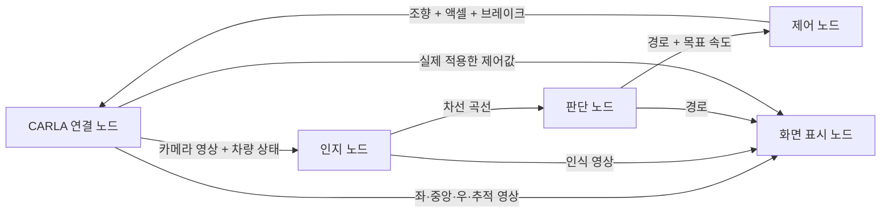

# ROS 2 토픽 기반 CARLA 주행

현재 기본 실행은 **서로 다른 프로세스의 ROS 2 노드 5개**입니다. 노드 사이에서는 Python 함수 호출 대신 DDS 토픽으로 데이터를 주고받습니다. 기존 알고리즘은 각 노드 안에서 계속 사용합니다.



## 1. 실행과 종료

이 노트북은 빌드를 완료했습니다. 새 터미널에서 한 줄을 입력하세요.

```bash
~/Desktop/PBB/start_ros2.sh
```

ROS 2 환경과 PBB 패키지 환경을 불러오고, CARLA 연결을 확인한 뒤 5개 노드를 실행합니다. Town10HD, Audi TT, 스폰 번호 21, 전방 카메라 3개와 추적 카메라 1개를 사용합니다. 주행 화면은 1200×828입니다. 노드 연결이 준비되면 자동으로 주행합니다.

기존 코드의 요청 속도 기본값은 **80km/h**를 유지합니다. 20km/h로 실행하려면:

```bash
~/Desktop/PBB/start_ros2.sh desired_speed_kmh:=20.0
```

`desired_speed_kmh`는 요청 속도입니다. 판단 파트의 차선 상태·곡률·가감속 제한에 따라 실제 제어 목표는 낮아질 수 있습니다.

화면의 `speed (km/h)`는 실제 차량 속도, `target (km/h)`는 이번 프레임의 목표입니다.
현재 판단 코드에는 50km/h 고정 제한이 없습니다. 요청 상한은 80km/h, 한쪽 차선만 유효할 때는 40km/h,
커브에서는 곡률에 따라 감속하며 목표 속도 증가도 1.5m/s²로 제한합니다.
`LEFT ONLY`/`RIGHT ONLY`이면 한쪽 차선 제한, `STOP`이면 차선·경로 유효성 검사를 확인하세요.
현재 실행 파일은 `src/pbb_decision/pbb_decision/lane_planner.py`입니다. IDE에 남은 옛 `aad/...` 경로와 구분하세요.

`FPS (real)`은 초당 실제 화면 갱신 수, `FPS (simulated)`는 시뮬레이션 설정입니다.
영상 전송에서 ROS의 uint8 버퍼를 사용해 Python의 픽셀별 반복 검사를 줄였습니다. 해상도·색상·프레임 시각은 유지합니다.


종료는 실행한 터미널에서 **Ctrl+C** 한 번입니다. 센서 정리를 위해 서버를 10초 동안 유지한 뒤 종료합니다. 화면 창을 닫거나 필수 노드가 종료돼도 전체 실행을 종료합니다. 기존 CARLA 서버가 켜져 있으면 먼저 종료하세요.

ROS 2 명령을 직접 사용하려면:

```bash
cd ~/Desktop/PBB
source /opt/ros/humble/setup.bash
source install/setup.bash
ros2 launch pbb_bringup pbb.launch.py desired_speed_kmh:=20.0
```

| 옵션 | 의미 |
|---|---|
| `desired_speed_kmh:=20.0` | 요청 속도 20km/h |
| `record:=true` | 실제 ROS 토픽을 rosbag2로 녹화 |
| `record_mode:=video` | 주행 화면·전방 원본·시계만 녹화 (부하와 용량 감소) |
| `record_mode:=all` | 기존 14개 토픽 녹화, 기본값 |
| `bag_path:=/원하는/새폴더` | 녹화 위치 지정. 기존 폴더에 덮어쓰지 않음 |
| `display:=false` | 화면 표시 노드를 제외한 실행 |
| `drive:=false` | CARLA 서버만 실행 |
| `startup_timeout:=180.0` | 서버·노드 준비 대기 시간 변경 |
| `command_timeout:=5.0` | 한 프레임의 제어 응답 대기 시간(실제 시간 기준) |
| `python_executable:=/절대경로/.venv/bin/python` | CARLA·Torch가 설치된 Python, 기본값은 현재 폴더의 .venv |
| `project_root:=/절대경로/PBB` | 녹화 위치의 기준 폴더, 기본값은 현재 폴더 |
| `carla_root:=/다른/CARLA` | CARLA 설치 위치 변경 |

## 2. 실행 중인 노드와 토픽 보기

주행을 켜 둔 상태에서 **다른 터미널**에 입력합니다.

```bash
source /opt/ros/humble/setup.bash
source ~/Desktop/PBB/install/setup.bash
ros2 node list
ros2 topic list
ros2 topic echo /pbb/control/command --once
```

노드 목록에는 `/pbb_bridge`, `/pbb_perception`, `/pbb_decision`, `/pbb_control`, `/pbb_display`가 나옵니다. 녹화 중에는 rosbag recorder도 추가됩니다.

메시지 구조와 연결 방향은 다음 명령으로 확인합니다.

```bash
ros2 interface show pbb_interfaces/msg/LaneEstimate
ros2 topic info /pbb/perception/lanes --verbose
ros2 topic hz /pbb/camera/center/image_raw
```

주행 중 요청 속도 변경:

```bash
ros2 param set /pbb_decision desired_speed_kmh 20.0
```

## 3. 데이터 계약

| 토픽 | 메시지 형식 | 발행 → 구독 |
|---|---|---|
| `/pbb/camera/left/image_raw` | `sensor_msgs/msg/Image` | bridge → display |
| `/pbb/camera/center/image_raw` | `sensor_msgs/msg/Image` | bridge → perception, display |
| `/pbb/camera/right/image_raw` | `sensor_msgs/msg/Image` | bridge → display |
| `/pbb/camera/chase/image_raw` | `sensor_msgs/msg/Image` | bridge → display |
| `/pbb/vehicle/state` | `pbb_interfaces/msg/FrameState` | bridge → perception, display |
| `/pbb/perception/lanes` | `pbb_interfaces/msg/LaneEstimate` | perception → decision |
| `/pbb/decision/plan` | `pbb_interfaces/msg/DrivePlan` | decision → control, display |
| `/pbb/control/command` | `pbb_interfaces/msg/VehicleControl` | control → bridge |
| `/pbb/control/applied` | `pbb_interfaces/msg/VehicleControl` | bridge → display, 기록·검사 |
| `/pbb/perception/overlay` | `sensor_msgs/msg/Image` | perception → display |
| `/pbb/perception/boundary` | `sensor_msgs/msg/Image` | perception → display |
| `/pbb/front/image/compressed` | `sensor_msgs/msg/CompressedImage` | bridge → 녹화·재생, 중앙 원본 PNG |
| `/pbb/screen/image/compressed` | `sensor_msgs/msg/CompressedImage` | display → 녹화·재생, 전체 화면 JPEG |
| `/clock` | `rosgraph_msgs/msg/Clock` | bridge → ROS 시뮬레이션 시계 |

전방 원본은 512×256 `rgb8`, 추적 원본은 800×600 `rgb8`입니다. 화면·전방 압축 토픽은 구독자가 있을 때 인코딩합니다. 차선 인식에는 중앙 영상만 사용합니다. 좌우 영상과 도로 경계 분석 미리보기는 현재 조향 입력에 포함하지 않습니다.

- `FrameState`: `frame_id=carla_vehicle`인 CARLA 좌표를 사용합니다. CARLA 프레임 번호, 실행 식별자, 시뮬레이션 시각, 속도(m/s), dt(초), 최대 조향각(rad).
- `LaneEstimate`: 왼쪽·오른쪽 곡선의 유효 여부와 다항식 계수. 계수 순서는 `c0 + c1*x + c2*x²`. 인지 좌표는 x 전방·y 왼쪽, 단위 m입니다.
- `DrivePlan`: 차량 좌표의 경로(x 전방·y 오른쪽, m), 목표 속도(km/h), 주행 허용, 정지 브레이크, 상태 문자열.
- `VehicleControl`: 원본 프레임 정보와 액셀·브레이크(0~1), 조향(-1~1), 목표 속도·상태.

같은 프레임의 이미지와 상태를 결합합니다. CARLA 연결 노드는 이번 실행·현재 프레임과 일치하는 유효한 명령만 적용합니다. 오래된 명령·다른 실행의 명령·NaN·범위 밖 명령은 거절합니다. 응답이 제한 시간 안에 오지 않으면 액셀 0, 브레이크 1을 적용합니다.

시뮬레이션은 한 프레임을 발행하고 제어 명령을 받은 뒤 다음 프레임을 진행하는 방식입니다. 시뮬레이션 dt는 1/30초이고, 실제 실행 FPS는 렌더링·추론·메시지 전송 시간에 따라 달라집니다. 영상 QoS는 reliable, keep-last 2이고 수치 메시지는 reliable, keep-last 4입니다. 이 연결 노드는 프로젝트용이며 별도 CARLA ROS bridge 패키지를 사용하지 않습니다. `carla_vehicle`는 CARLA의 x 전방·y 오른쪽 좌표이며 ROS 표준 `base_link`와 구분합니다. TF 트리와 CameraInfo 발행은 현재 포함하지 않습니다.

## 4. 담당자가 수정할 파일

| 담당 | 기존 알고리즘 | ROS 연결 코드 |
|---|---|---|
| 인지 | `src/pbb_perception/pbb_perception/lane_perception.py`, `lane_detector.py` | `src/pbb_perception/pbb_perception/node.py` |
| 판단 | `src/pbb_decision/pbb_decision/lane_planner.py` | `src/pbb_decision/pbb_decision/node.py` |
| 제어 | `src/pbb_control/pbb_control/vehicle_controller.py` | `src/pbb_control/pbb_control/node.py` |
| CARLA 연결 | 센서 생성·프레임 진행·명령 적용 | `src/pbb_carla/pbb_carla/node.py` |
| 화면 | 토픽 구독·주행 화면 표시 | `src/pbb_visualization/pbb_visualization/node.py` |
| 공통 계약 | ROS 메시지 필드 | `src/pbb_interfaces/msg/` |

Python 코드 변경은 저장 후 전체 실행을 재시작하면 반영됩니다. `.msg`, `package.xml`, `setup.py` 변경 시에는 먼저 다시 빌드하세요.

```bash
~/Desktop/PBB/build_ros2.sh
```

노드 하나만 시험할 때는 전체 주행을 종료한 뒤, 다른 터미널에서 필요한 입력 토픽을 발행하거나 bag으로 재생해야 합니다. 예를 들어 제어 노드는 다음과 같이 단독 실행할 수 있습니다.

```bash
source /opt/ros/humble/setup.bash
source ~/Desktop/PBB/install/setup.bash
ros2 run --prefix ~/Desktop/PBB/.venv/bin/python pbb_control control
```

## 5. ROS 토픽 녹화와 재생

주행 화면과 중앙 원본만 필요하면 다음 명령을 사용합니다. 화면 안에는 좌·중앙·우 카메라가 모두 표시됩니다.

```bash
~/Desktop/PBB/start_ros2.sh desired_speed_kmh:=80.0 record:=true record_mode:=video
```

video 모드는 화면 JPEG·중앙 PNG·시계 토픽 3개를 기록합니다. 아래 기존 명령은 전체 14개 토픽을 기록합니다.

```bash
~/Desktop/PBB/start_ros2.sh desired_speed_kmh:=20.0 record:=true
```

`PBB/bags/ros2_town10_날짜_시간/`에 `metadata.yaml`과 `.db3`를 저장합니다. 이제 `ros2 bag record`가 실제 발행된 위 14개 토픽을 구독합니다. 원본 영상과 중간 판단·제어 데이터까지 포함하므로 이전 화면 2개 녹화보다 용량이 커집니다. Ctrl+C 이후 recorder의 `Recording stopped`를 확인하세요.

저장한 폴더의 실제 이름으로 바꿔서 실행합니다.

```bash
source /opt/ros/humble/setup.bash
source ~/Desktop/PBB/install/setup.bash
ros2 bag info ~/Desktop/PBB/bags/저장한폴더이름
ros2 bag play ~/Desktop/PBB/bags/저장한폴더이름
```

재생은 실제 주행을 종료한 상태에서 합니다. 화면만 보려면 두 압축 토픽만 선택해서 재생하고 `rqt_image_view`에서 선택하세요.

```bash
ros2 bag play ~/Desktop/PBB/bags/저장한폴더이름 --topics /pbb/screen/image/compressed /pbb/front/image/compressed
```

재생을 켜 둔 채 다른 터미널에서 `source /opt/ros/humble/setup.bash` 후 `rqt_image_view`를 실행합니다.

팀원이 사용자 정의 차선·판단·제어 메시지를 읽으려면 PBB를 받아 `build_ros2.sh`를 실행하고 `install/setup.bash`를 불러와야 합니다. 표준 이미지 토픽을 보는 것과 별개입니다. 공유는 기존처럼 bag 폴더 전체를 압축해 GitHub Release에 올립니다. `build`, `install`, `log`, `bags`는 Git에서 제외합니다.

## 6. 검사와 파일 이동

```bash
~/Desktop/PBB/test_ros2.sh
```

직렬화·영상·프레임 일치·명령 거절, 독립 판단/제어 패키지의 DDS 통신, 현재 launch의 실행·종료를 검사합니다.
전체 Town10 경로 성능 검증과는 별개입니다.
현재 실행은 src의 설치된 패키지만 사용합니다. 알고리즘과 ROS 노드가 각 담당 패키지에 함께 있습니다.
모델도 인지 패키지의 공유 경로에서 찾습니다. [이전 위치 → 새 위치](ros2_migration.md)를 참고하세요.
