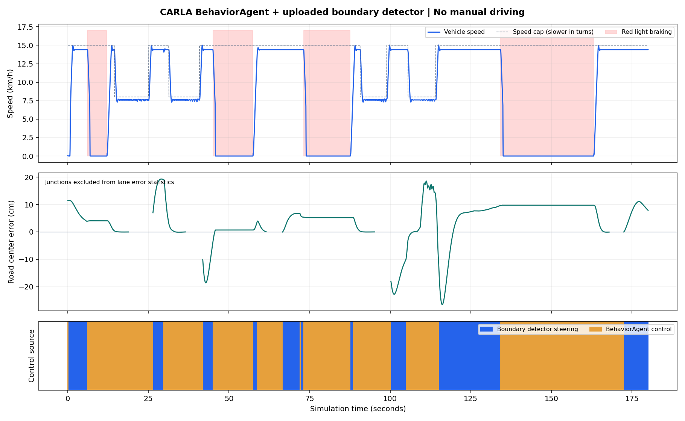

# CARLA 경계 검출 기반 자동주행 예제

첨부 도로 경계 검출기의 출력이 실제 조향에 쓰이도록 연결하고, CARLA 공식 **BehaviorAgent 0.9.16 (MIT)** 로 경로 계획·신호 정지·교차로 회전을 수행한 실행 코드입니다. 자동 출발하고 목적지를 순환하므로 수동 운전 없이 확인할 수 있습니다.

현재 검증한 실행 형태를 보존한 독립 예제입니다. `src/pbb` 모듈로 분리하는 작업은 [기존 코드 이관 순서](../../docs/architecture.md#기존-코드-이관-순서)에 따라 별도 진행합니다.

## 검증 결과

| 항목 | 2026-11-09 실행 결과 |
| --- | --- |
| 환경 | CARLA 0.9.16, Town02_Opt, 낮, 다른 차량·보행자 없음 |
| 기록 구간 | 180초 / 3,601프레임 / 395.58m |
| 신호 | 자연 신호 주기에서 빨간불 정지 4회, 초록불 출발 4회 |
| 출발 지연 | 초록 전환 후 0.30~0.35초에 1.8km/h 초과 |
| 교차로 회전 | 3회 |
| 차로 중심 절대오차 | 평균 6.95cm / 95백분위 19.25cm / 최대 26.52cm |
| 충돌 / 차선 침범 센서 | 0회 / 0회 |
| 차체 영역의 일반 차로 이탈 | 0프레임 |
| 첨부 검출 기반 조향 | 이동 프레임의 43.03% |
| 수동 운전 | 0회 |

차로 통계는 속도 1km/h 초과, 교차로 바깥 프레임에서 계산했습니다. 영상만으로 모든 주행 정보를 인식하는 시스템은 아닙니다. 신호·경로·주변 객체는 CARLA API를 사용하며 첨부 검출값은 적합한 직선 구간에서 실제 조향에 사용합니다. 회전·검출 누락·제동 시에는 BehaviorAgent를 사용합니다. 장애물 회피, 악천후, 야간, 실차 성능은 위 시험에 포함되지 않습니다.



- [최종 보고서](validation/20261109-214402/검증결과.txt), [수치](validation/20261109-214402/summary.json), [프레임·해시 검증](validation/20261109-214402/verification.json)
- [앞선 직진·좌우 30cm 출발 시험](validation/20261108-231006/검증결과.txt): 신호 정지·출발 3/3회 통과
- 기록에는 원본 코드 해시와 압축한 프레임 로그를 포함합니다. 전체 MP4와 설치 패키지는 Git에 포함하지 않았습니다. 녹화 원본은 로컬에 보관되어 있으며 새 실행 시 자동 녹화합니다.

## 환경 준비

검증 환경은 Ubuntu 22.04, 시스템 Python 3.10, NVIDIA GPU, CARLA 서버/API 0.9.16입니다. Linux에서 실행하고 Tk 창을 띄울 디스플레이가 필요합니다. CARLA 서버는 별도 설치해야 합니다.

저장소 루트에서 다음 폴더로 이동합니다.

```bash
cd examples/carla_boundary
export CARLA_ROOT="$HOME/CARLA"  # CarlaUE4.sh가 있는 설치 폴더
```

새 Ubuntu 환경에서 필요한 시스템 패키지와 Python API를 준비하는 예입니다.

```bash
sudo apt install python3-pip python3-numpy python3-opencv python3-pil python3-pil.imagetk python3-tk python3-matplotlib
/usr/bin/python3 -m pip install --target .carla-python --no-deps carla==0.9.16
/usr/bin/python3 -m pip install --target .autonomy-deps --no-deps -r requirements-autonomy.txt
```

OpenCV의 H.264 인코더가 필요합니다. 검증에는 Ubuntu의 `python3-opencv`를 사용했습니다. 인코더가 없는 빌드에서는 영상 저장 초기화 단계에서 오류를 내고 종료합니다.

자동 서버 실행을 사용할 때는 **서버가 종료된 상태에서** 아래 설정을 한 번 적용합니다. 기존 설정을 백업하고 시작 지도를 Town02_Opt, 프레임 제한을 20FPS로 설정합니다.

```bash
/usr/bin/python3 configure_carla.py
```

동봉 서버 실행기는 검증한 노트북의 NVIDIA 설정을 사용하고, 시작 전 여유 RAM 6GiB와 스왑 약 16GiB를 요구합니다. 다른 컴퓨터에서는 CARLA 0.9.16을 직접 실행하고 Town02_Opt를 로드한 뒤 클라이언트를 연결해도 됩니다. `setup_carla_swap.sh`는 Ubuntu/ext4 환경에서 16GiB 스왑 파일을 만들고 `/etc/fstab`을 백업·수정하는 선택 도구이며 자동 실행되지 않습니다.

## 실행

```bash
./run_open_source_autonomy.sh --reset --record-seconds 180
```

차량은 자동 출발하고 목적지를 순환합니다. Space로 일시정지·재개, Esc로 차량을 세우고 종료합니다. `--seconds 180`을 추가하면 180초 후 종료합니다. `--agent-only`를 추가하면 첨부 검출값의 조향 개입 없이 공식 에이전트만 비교할 수 있습니다. 상세 내용은 [사용법](USAGE.ko.md)을 참고하세요.

서버가 없으면 자동으로 시작합니다. 기본 최고 속도는 15km/h이며 곡선 접근 시 8km/h로 감속합니다. 다른 동기식 CARLA 클라이언트를 함께 실행하지 마세요. 주행 창을 닫아도 서버는 유지되며, 이 폴더에서 시작한 서버는 `python3 stop_carla.py`로 종료합니다.

이전 방식의 반복 직진 시험도 포함합니다. 이 시험은 빨간불 정지를 확인한 뒤 시험기가 초록불로 전환합니다.

```bash
/usr/bin/python3 autonomous_boundary_drive.py --cycles 3 --keep-open
```

## 코드와 검사

| 파일 | 용도 |
| --- | --- |
| `open_source_autonomy.py` | 공식 BehaviorAgent와 영상 조향을 연결한 반복 자동주행 |
| `road_boundary_recovery/road_boundary_recovery.py` | 첨부 검출 원본 |
| `boundary_controller.py` | 영상 목표점 변환과 조향·속도 제어 함수 |
| `autonomous_boundary_drive.py` | 빨간불 정지·초록 출발·좌우 초기 편차 반복 시험 |
| `run_boundary_carla.py` | 최초 검출 확인용 뷰어 |
| `analyze_open_source_run.py` | 자동주행 기록 검증과 보고서 생성 |
| `analyze_autonomous_test.py` | 반복 직진 시험 보고서 생성 |
| `third_party/carla_agents/` | 수정하지 않은 공식 소스, MIT 라이선스, 원본 해시 |

```bash
python3 -m unittest test_boundary_controller.py -v
python3 -m compileall -q .
python3 analyze_open_source_run.py opensource-runs/실행폴더
```

분석기는 해당 실행의 `drive.mp4`, `frames.jsonl`, `summary.json`을 읽습니다. 저장소에 보관한 압축 로그는 `gzip -dk validation/20261109-214402/frames.jsonl.gz`로 풀 수 있습니다. 보관 기록의 전체 분석을 다시 실행하려면 원본 영상도 필요하며, 이전 `verification.json`은 원본 영상까지 검사한 당시 결과입니다.

주행 제어·검출 원본은 검증 당시 파일과 동일합니다. 게시 과정에서 서버 실행·설정 스크립트의 사용자 고정 설치 경로만 `CARLA_ROOT`(기본 `~/CARLA`)로 바꿨습니다. 그 두 파일은 별도 환경에서 서버 실행 검증이 필요합니다.

## 출처와 라이선스

- [CARLA 0.9.16 navigation agents](https://github.com/carla-simulator/carla/tree/0.9.16/PythonAPI/carla/agents), [MIT 원문](third_party/carla_agents/LICENSE), [파일 해시](third_party/carla_agents/UPSTREAM.json)
- [공식 에이전트 설명](https://carla.readthedocs.io/en/0.9.16/adv_agents/)
- `road_boundary_recovery`는 사용자가 제공한 파일입니다. 원본 설명을 함께 보존하며 CARLA의 MIT 라이선스를 첨부 코드나 프로젝트 전체에 확대 적용하지 않습니다.
